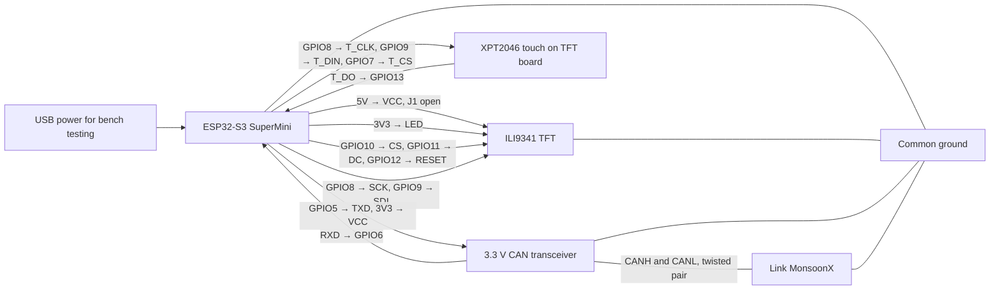

# Touch Screen CAN v1.1.0

Single-screen Link Generic Dash instrument for an ESP32-S3 SuperMini
(ESP32-S3FH4R2, 4 MB flash), an ILI9341 240×320 SPI display with XPT2046 resistive
touch, and a 3.3 V CAN transceiver. It compiles the CAN receiver, Link decoder,
reading conversions, and coolant thresholds from the same code used by
[Dual Gauge CAN](../dual-gauge-can/README.md). Build from the full repository.

[Bill of materials](docs/BOM.md) · [Wiring diagram](#wiring-diagram) ·
[v1.1.0 release notes](docs/release-v1.1.0.md) ·
[v1.0.0 release notes](docs/release-v1.0.0.md)

## Wiring

| Module pin | ESP32 or vehicle connection |
| --- | --- |
| TFT VCC | USB-powered board 5V, with TFT J1 open. Verify the board's 5V rail first. |
| TFT GND | GND |
| TFT CS | GPIO10 |
| TFT RESET | GPIO12 |
| TFT DC | GPIO11 |
| TFT SDI (MOSI), T_DIN | GPIO9, shared |
| TFT SCK, T_CLK | GPIO8, shared |
| TFT LED | 3V3 for always-on backlight on the V1.2 breakout |
| TFT T_CS | GPIO7 |
| TFT T_DO | GPIO13 |
| TFT SDO (MISO), T_IRQ, SD_* | Open |
| CAN transceiver TXD / CTX | GPIO5 (ESP32 output) |
| CAN transceiver RXD / CRX | GPIO6 (ESP32 input) |
| CAN transceiver VCC | 3V3, for a 3.3 V transceiver |
| CAN transceiver GND | ESP32 GND and ECU CAN ground reference |
| CANH / CANL | ECU CAN-H / CAN-L via twisted pair |

See the [vehicle connection notes](../dual-gauge-can/docs/vehicle-connection.md)
for termination and vehicle power. This pinout assumes a transceiver with TXD
and RXD logic pins.

### Wiring diagram

## Build and use

From this directory, run `pio run`, then
`pio run -t upload --upload-port YOUR_PORT`. Open a 115200-baud serial monitor
for CAN status and touch diagnostics. Use `j` to list observed CAN IDs and
Link mux snapshots. Send `c` to restart touch calibration.

At power-up, a Honda H splash fades out before the gauges appear. Set
`instrumentConfig::showHondaSplash` to `false` in
[`include/instrument_config.h`](include/instrument_config.h), then rebuild and
upload to start directly on the gauges or first-run calibration.

At first boot, tap and release the three crosshairs. Tap anywhere on the gauge
screen to open the menu, then tap the **LEFT** or **RIGHT** cell next to a gauge
to assign it to that side. Tap **DONE** to return to the two gauges. Either side
can show the same gauge.

Flash storage remembers both assignments and calibration.
The default pair is coolant on the left and RPM on the right. Updating from
the single-gauge firmware keeps the old gauge on the left and defaults the right
to RPM (coolant if the saved gauge was RPM). To repeat calibration, choose
**CALIBRATE** from the menu.

The five options are coolant temperature, RPM, boost (MAP minus barometric
pressure), ECU supply voltage, and intake air temperature.
The gauge distinguishes waiting, stale, and invalid readings.
The RPM bar changes from blue at zero to green at 900 RPM, then through
yellow to red at 6,500 RPM. The red **LIMIT** label appears at or above
6,500 RPM. Set `instrumentConfig::rpmIdle` and `instrumentConfig::rpmLimit`
in [`include/instrument_config.h`](include/instrument_config.h) to change
the idle and redline points, then rebuild and upload.

### Demo mode

On the bench, tap anywhere on the gauge screen, tap **DEMO OFF** to turn it on,
then tap **DONE**.
The gauges use the same changing sample readings as Dual Gauge CAN and show
**DEMO / SIMULATED** in orange. Tap **DEMO ON** in the menu to return to live
readings, or send `d` over USB serial to toggle the source directly. The
`GAUGE` serial lines identify each side, source, and displayed value.

Demo mode starts off after every reboot. CAN reception continues in the
configured mode, with simulated values kept separate. When you exit demo mode,
the display waits for fresh ECU readings.

The default CAN settings match the working CR-V and Link MonsoonX setup.
The receiver uses Classic CAN at 500 kbit/s with standard ID 1000. It
acknowledges valid CAN traffic and sends no application messages. Use
`pio run -e listen-only -t upload --upload-port YOUR_PORT` for passive monitoring
when another node already acknowledges the ECU.

## Bench verification

Both PlatformIO environments compile. The normal build was flashed and verified
over USB on the 4 MB / 2 MB SuperMini. It initialized SPI and settings storage,
entered touch calibration, and reported zero receive errors with the CAN bus
disconnected. The owner then confirmed that all five gauges received and
displayed live data in the CR-V with the Link MonsoonX. The owner noticed visible
flashing on fast-changing readings such as voltage. The display now composes
the digits in RAM before sending them and redraws only the changing portion of
the bar. The redraw change still needs an in-car check.
